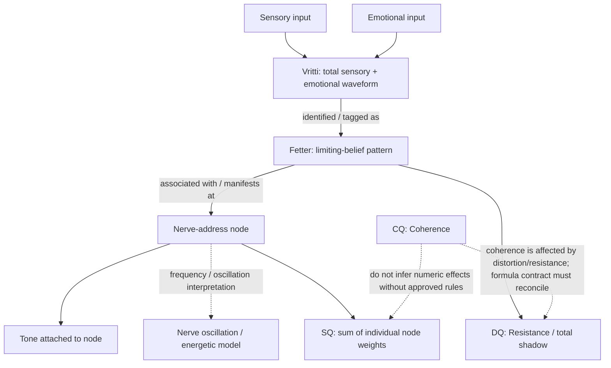

# ATÜNED Unified Vritti–Fetter–Nerve Node Architecture
Version: 1.0
Date: 2026-10-21
Status: Owner-directed architecture priority; implementation contract, not a claim of validated biophysics.

## Executive ruling
Vritti is not a separate collection of independent observations in the conceptual model. It is the **total waveform** of sensory input combined with emotional input that is identified/tagged as a limiting belief. The limiting belief is the **fetter**. The **tone is attached to the nerve-address node**. The nerve is described by the model as oscillating energy at that frequency.

These are three connected layers of one model:
1. **Vritti / signal layer** — the total sensory-emotional waveform.
2. **Fetter / pattern layer** — the limiting-belief identity assigned to or associated with that waveform.
3. **Nerve-address node / tone layer** — the node at the address, with its tone/frequency reference.

The architecture should express the three layers through the engine's existing record owners and trace graph. Do not create a second profile inventory or a duplicate shadow/fetter registry. The previous draft's proposal to add a top-level `p.vritti[]` collection was premature and has been reverted from the execution branch. The conceptual relationship must be modeled first; the storage shape should follow the canonical owners.

## 1. The relationship diagram

Read the arrows carefully:
- Sensory and emotional inputs compose the Vritti waveform.
- A Vritti being *tagged as* a limiting belief means an interpretation/identification relationship, not that raw sensory data is itself a belief.
- The fetter is the named pattern identity.
- The fetter connects to the nerve-address node(s) where its tone is represented.
- Tone/frequency belongs to the node/address relationship, not as a new fetter and not as an independent CQ/DQ/SQ score.
- DQ and SQ are related to the shadow/fetter/node architecture but remain different aggregates. Do not sum the same weight twice.

## 2. Three architecture reviews

### Review 1 — Ontology and semantic boundaries
**Question:** Are these three names describing one object three times, or three layers with typed relationships?

**Decision:** Three layers, one connected model. Vritti is signal; fetter is pattern/interpretation; nerve-address node is the addressed model location carrying tone. A single flat record would blur raw input, inferred interpretation, and node properties. A standalone Vritti collection would also risk making Vritti an independent inventory rather than a signal representation anchored to existing record owners.

**Rules**
- Keep raw sensory and emotional reports distinct from any normalized waveform representation.
- Preserve the user's exact belief wording separately from the canonical fetter ID.
- Association and identification carry provenance: inferred, observed, proposed, or user-confirmed.
- Do not equate “tagged as a limiting belief” with scientific proof that the belief caused a physiological waveform.
- The tone is a property/reference of the nerve-address node; do not duplicate tone as an unrelated fetter attribute unless the existing node schema requires a derived view.

### Review 2 — Engine, records, and metric ownership
**Question:** Where should the relationship live so it survives reload and affects the right computations without parallel truth?

**Decision:** First reuse the canonical owners:
- **Fetter/pattern owner:** canonical identity, user wording, pattern evidence, and confirmation status.
- **Nerve-address/node owner:** canonical address ID, node identity, tone/frequency reference, and individual node weight.
- **Source/journal/imprint owner:** sensory and emotional input, context, time, and source evidence.
- **Trace graph:** typed relationships between the existing records; derived relationships should be derived, and relationships requiring a person's judgment should be stored with provenance.
- **CQ/DQ/SQ compute owner:** reads canonical node/fetter weights and approved evidence; does not store a parallel Vritti score.

Do not add a top-level Vritti array simply because the word Vritti needs to exist. If the existing source/imprint record can hold the signal payload and trace can link it to a fetter and nerve node, extend those records in place. Only introduce a new persisted record type if source inspection proves no existing record can own a durable waveform payload without violating record semantics. If so, the new type must be explicitly integrated into the existing profile boundary and trace graph—not left as an isolated collection.

### Review 3 — Failure modes, evidence, and scientific restraint
**Question:** What would make the model look connected while actually being misleading?

**Risks and controls**
- **Duplicate source of truth:** tone, fetter identity, and Vritti are copied to several records. Control: canonical owner per field; other surfaces derive links.
- **False causality:** “associated with” is silently rendered as “caused by.” Control: relationship vocabulary and provenance remain explicit.
- **Metric leakage:** marker count or waveform intensity silently changes CQ/DQ/SQ. Control: metric isolation and regression tests.
- **False precision:** a numeric frequency or waveform amplitude is invented without a defined measurement method/units. Control: preserve symbolic/qualitative representation until units and acquisition method are specified.
- **One-to-one assumption:** a fetter is forced to exactly one address or one waveform. Control: support the actual cardinality established by canonical domain rules; default to link cardinality without copying records.
- **Inferred treated as confirmed:** lexical or model inference becomes a fact. Control: candidate/proposed/inferred remains distinct until explicit confirmation.
- **Transient activation treated as stored charge:** momentary emotional intensity is conflated with durable resistance. Control: separate observation, charge estimate, and baseline.
- **CQ formula split:** conceptual `CQ = (Integrity × Intention) / Resistance` and existing 21-law CQ implementation become two active calculators. Control: preserve the owner-approved conceptual relationship and the existing engine behavior as versioned contracts until one reconciled calculation/derivation contract is explicitly accepted; never silently create a second CQ output.

## 3. Canonical three-layer field/relationship contract

### Signal / Vritti payload
- source reference to the existing journal/imprint/observation record;
- sensory input (raw and source);
- emotional input (raw and source);
- combined waveform representation, if available;
- method and units only when defined; otherwise null/qualitative;
- context and observed timestamp;
- provenance and confidence;
- optional canonical fetter association with relationship status/evidence.

### Pattern / fetter
- canonical fetter/node type and ID;
- exact user language / limiting-belief phrase;
- identification state: candidate, confirmed, rejected;
- supporting and contradicting evidence;
- linked Vritti/source references;
- linked nerve-address node references;
- no duplicated waveform payload and no marker stored as independent truth.

### Nerve-address node / tone
- canonical node/address ID;
- tone/frequency reference attached to that node;
- representation type and units/method if known;
- associated fetter references and provenance;
- individual node weight owned by the current node/weight system;
- no automatic weight changes merely because a Vritti or marker was added.

### Relationship types
Use the current trace vocabulary and validation allowlist. Prefer existing edge types such as `supports`, `associated_with`, or `addresses` where their defined direction and semantics match. Do not introduce a new edge name until the trace TDD, validator, cycle rules, UI labels, and tests are updated together. Do not use `causes` unless the relationship is explicitly user-confirmed or otherwise justified by the current causal-claim contract.

## 4. CQ / DQ / SQ integration
- **CQ = Coherence.** It is one named measure, not separate CQ and Coherence outputs.
- **DQ = Resistance / total shadow**, using the current canonical implementation pending any approved formula revision.
- **SQ = total shadow weight**, the sum of individual node weights.
- **Fetter = the name/type of an individual node**; its individual weight contributes to SQ.
- Vritti is not a fourth score and must not be directly added to CQ, DQ, or SQ.
- A Vritti-to-fetter identification can supply evidence to a pattern assessment. It does not by itself alter weight or prove that resistance changed.
- A node tone/frequency reference describes the node; it is not an implicit multiplier.
- Existing release lift must remain single-owned in the current engine. Do not duplicate it in Vritti processing, trace, or the UI.
- The conceptual formula `CQ = (Integrity × Intention) / Resistance` must be reconciled with the engine's 21-law calculation by a versioned decision. Do not ship two competing calculators or silently change historical meaning.

## 5. Prioritized implementation plan

### P0 — Record/engine ontology and owner map
1. Map current journal/story/imprint records, fetter/pattern identity, nerve-address nodes, node tone/frequency fields, trace graph, and metric calculation.
2. Identify which existing record owns the sensory input, emotional input, belief wording, tone, address, and node weight.
3. Document source → fetter and fetter → node relationships using existing record IDs.
4. Remove any proposed standalone Vritti collection that duplicates or floats outside those owners.

**Acceptance:** field-to-owner table exists; every field has one canonical owner; no parallel fetter or Vritti inventory is introduced without a documented necessity.

### P1 — Typed trace relationship
1. Add or derive the Vritti/signal-to-fetter relationship using the current graph model.
2. Add or derive the fetter-to-nerve-node/tone relationship.
3. Preserve inferred/proposed/user-confirmed/observed provenance.
4. Validate endpoint IDs against existing canonical IDs.
5. Make the trace graph display the three-layer chain without implying causation.

**Acceptance:** round-trip, duplicate, unresolved-link, provenance, and graph-validation tests pass.

### P2 — Record and UI presentation
1. Show the waveform/source evidence at the signal record.
2. Show the fetter's relationship marker only when a valid association exists.
3. From the fetter, navigate to source/Vritti evidence and the nerve-address node.
4. At the node, display its tone/frequency reference and associated fetter(s).
5. Show unresolved/candidate/confirmed states distinctly.

**Acceptance:** UI links all three existing owners; no duplicate payload or marker truth; candidate associations never look confirmed.

### P3 — Metric wiring and regression
1. Verify node weight is the only individual contribution to SQ.
2. Verify DQ is calculated by its canonical owner and not inferred as a CQ complement.
3. Verify CQ is calculated by one reconciled, versioned contract.
4. Assert that merely linking a Vritti, changing marker display, or viewing tone does not mutate metrics.
5. Verify only owner-approved evidence/operations can change weight.

**Acceptance:** metric snapshots remain unchanged for relationship-only edits; approved metric changes have named tests.

### P4 — Full-stack validation
Run build, engine tests, trace tests, UI/release-chain tests, export/import, reload, and migration tests. Capture actual run links and results. Report failures rather than masking them.

## 6. Acceptance test matrix
1. Sensory and emotional inputs combine into one conceptual Vritti waveform reference without deleting either raw input.
2. Vritti can be associated with a fetter while preserving the source record and exact user wording.
3. A fetter links to one or more canonical nerve-address nodes without duplicating the fetter.
4. The tone reference is read from the node owner, not independently copied into a Vritti store.
5. The UI can traverse signal → fetter → node/tone and back to evidence.
6. Candidate/inferred links remain visibly distinct from user-confirmed links.
7. Invalid/missing endpoints are reported as unresolved, never silently reassigned.
8. A relationship-only edit does not change CQ, DQ, SQ, node weight, or release-hit count.
9. No edge is labelled causal solely because it exists in the graph.
10. Old profiles load without losing data; export/import and reload preserve links.
11. The current 21-law CQ calculation and the conceptual Integrity × Intention / Resistance relationship are not both silently presented as independent canonical CQ calculators.
12. Repeated processing is idempotent and does not duplicate links or evidence.

## 7. Current implementation boundary
The repository currently has a strict profile validation boundary and a trace graph with an allowlisted set of node and edge types. The architecture must be implemented through those owners. The prior draft change that added a top-level `p.vritti[]` collection was reverted from the working execution branch after the owner clarified that Vritti is the total waveform connecting the signal, limiting-belief/fetter, and nerve-node/tone layers.

This document defines the prioritized target model and review findings. It does not claim that the three-layer runtime wiring or tests are complete.
