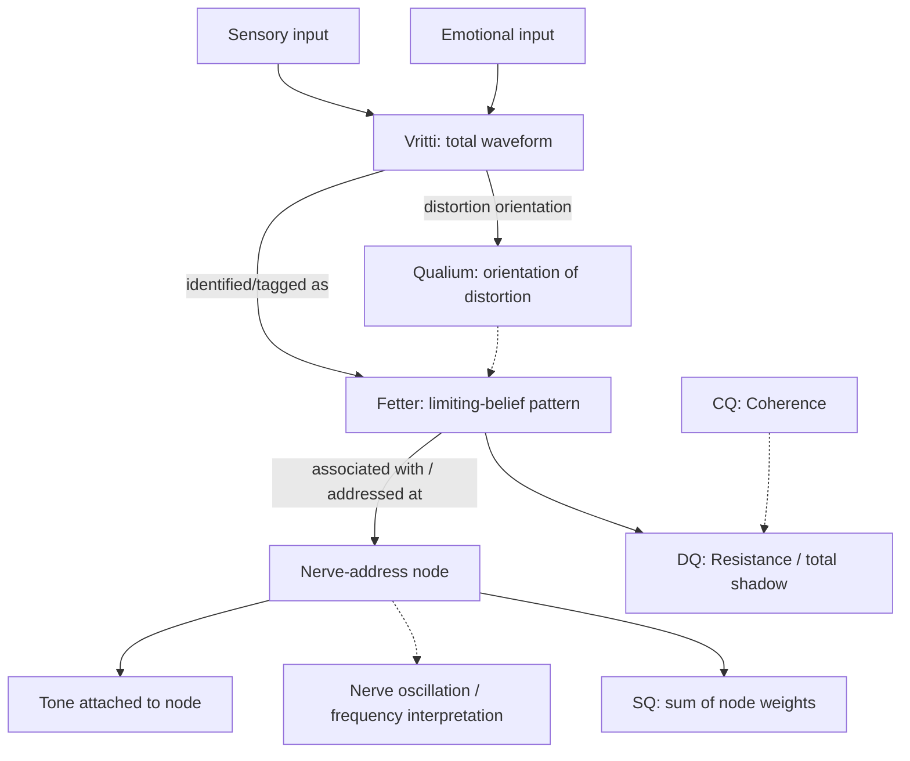

# ATÜNED Vritti — Unified Signal, Fetter, Qualium, and Nerve-Node TDD
Version: 1.2
Date: 2026-10-21
Status: Signal-to-fetter trace, FLOWSEAT tone-reference derivation, and source-backed marker/navigation implemented on `atuned/mvp-alpha-recursive-execution`; regression assertions added, execution evidence pending.

## 1. Purpose
Define the unified relationship between:
1. Vritti — the total waveform of sensory input plus emotional input, identified/tagged as a limiting belief.
2. Fetter — the limiting-belief pattern identity in the engine.
3. Nerve-address node — the canonical address node to which tone is attached and at which the model represents nerve oscillation at that frequency.
4. Qualium — the orientation of distortion. This is a distinct semantic dimension, not the waveform, fetter identity, node address, or tone. Its vocabulary and canonical record owner must be mapped before adding a runtime field or enum.

These are three connected layers of one model, not three independent inventories. The normative architecture and priority order are in `docs/ATUNED_UNIFIED_VRITTI_FETTER_NERVE_NODE_ARCHITECTURE_v1.md`.

## 2. Canonical definitions
- **Vritti** (V-R-I-T-T-I): the total sensory-emotional waveform. Preserve sensory and emotional source inputs separately; the waveform is their combined representation.
- **Fetter**: the name/type of a limiting-belief pattern node. The exact user's belief wording is evidence and must not be replaced by a canonical label.
- **Nerve-address node**: the canonical address record in the engine. Tone belongs to this node/address, not to a separate Vritti inventory.
- **Tone/frequency**: a property/reference owned by the nerve-address node. Units and acquisition method must be defined before treating the value as a measured physical frequency.
- **Qualium**: the orientation of distortion. Do not assume it means inward/outward, or that it is equivalent to the existing node-table distortion descriptor, until a domain mapping explicitly establishes that.
- **Association**: a typed, provenance-bearing relationship linking source/waveform evidence to a fetter and the fetter to relevant nerve-address node(s), with qualium orientation preserved as a distinct interpretation where the domain contract supports it.
- **Marker**: a derived UI affordance on the fetter/node view when a valid relationship exists. It is not a score, causal proof, or separate source of truth.

## 3. Three-layer relationship

Relationship semantics:
- Sensory and emotional input contribute to the Vritti waveform.
- The identification of a waveform as a limiting belief is an interpretation relationship with provenance, not proof that raw sensory input is itself a belief.
- The fetter is the named pattern identity.
- The fetter connects to the node/address where tone is represented.
- Vritti/fetter/node relationships must not imply causation unless the causal-claim contract permits it.
- Do not assume one-to-one cardinality without a canonical domain rule. Prefer references to existing records over copying the same payload into multiple records.

## 4. Record ownership — required before adding storage
Use existing canonical record owners:
- Journal/source/imprint/observation owner: sensory input, emotional input, context, timestamp, raw language, and source evidence.
- Fetter/pattern owner: canonical fetter ID, exact limiting-belief wording, identification state, supporting/contradicting evidence.
- Nerve-address node owner: canonical address ID, tone/frequency reference, method/units when defined, individual node weight.
- Qualium owner: unresolved pending domain mapping. Existing `NODES` rows carry a `d` distortion descriptor and the compute engine separately models inward/outward charge balance; neither is declared canonical qualium without explicit semantic confirmation.
- Trace graph: relationships that cannot be safely derived from the existing record owners; preserve provenance.
- CQ/DQ/SQ compute owner: reads the canonical node weights and approved evidence.

Do **not** add a top-level standalone `p.vritti[]` collection merely to name this concept. The prior draft implementation proposal for that collection was reverted after the owner clarified that Vritti is the waveform connecting existing signal, fetter, and node layers. Introduce a new persisted record type only if source inspection proves none of the existing owners can hold the signal payload without breaking its semantics. Any such exception must be integrated into existing persistence and trace boundaries, not left as an independent inventory.

## 5. Qualium semantics and isolation
- Qualium means the **orientation of distortion**.
- Do not conflate qualium with Vritti waveform, fetter/limiting-belief identity, nerve-address node, tone/frequency, node weight, or the node-table `d` descriptor.
- Do not assume inward/outward charge balance is the qualium taxonomy. It may be related, but that relationship must be explicitly established.
- Until the canonical vocabulary and record owner are mapped, represent qualium in architecture and requirements, not as an invented persisted field or numeric score.

## 6. Canonical metrics and isolation
- CQ = Coherence; these are not separate outputs.
- DQ = Resistance / total shadow, under the existing canonical implementation until a versioned formula change is accepted.
- SQ = sum of individual node/fetter weights.
- Fetter = name/type of an individual node; its weight contributes to SQ.
- Do not calculate DQ as `100 - CQ`.
- A Vritti association, tone marker, trace edge, or view action does not itself alter CQ, DQ, SQ, node weight, release-hit count, or stored-charge estimate.
- The conceptual formula `CQ = (Integrity × Intention) / Resistance` must be reconciled with the existing 21-law CQ engine by one versioned decision. Do not ship two competing canonical CQ calculators.
- The current release-lift implementation remains single-owned; do not duplicate it in this layer.

## 7A. Implemented minimum derived trace path (2026-10-21)

The branch implementation in `atuned_src/engine/trace.js` now derives the following without adding a standalone `p.vritti[]` collection:

- `story:<entry-id> produces impression:<entry-id>` with `inferred` provenance. The impression is a derived signal-reading layer, not a claim that the complete sensory-emotional waveform is already persisted.
- `impression:<entry-id> supports pattern:fetter:<canonical-name>` with `inferred` provenance when the story parser returns a canonical fetter label.
- `story:<entry-id> supports pattern:<address-id>` remains unchanged for existing consumers.
- `pattern:<address-id> associated_with pattern:fetter:<canonical-name>` is derived from canonical `NODES[].cf` membership with `known` provenance. This is classification/association, not a claim about the person's current state or a causal claim.
- All of these links are derived on read. They do not mutate the profile, CQ, DQ, SQ, node weights, stored charge, or release-hit state.

Regression assertions were added in `tests/trace.js` for path traversal, provenance, canonical address membership, no duplicate Vritti collection, and metric isolation. These assertions are **not considered verified until the candidate revision's test workflow completes successfully**.

Still outside this minimum closure: a canonical qualium value/owner contract and durable structured sensory/emotional waveform capture. `FLOWSEAT`/`seatHz` are located in `engine/data/practice.js`; `ui/release.js` and `ui/map.js` are existing consumers. `tracePatternAttrs` resolves the configured seat-tone reference onto the derived address node. `ui/loopread.js` renders a source-backed marker with story text and candidate provenance. Test execution and export/import/reload behavior remain unverified.

## 7. Relationship provenance and state
Every relationship must use the trace graph's existing allowed edge vocabulary and provenance rules. Candidate/inferred, proposed, observed, and user-confirmed relationships remain distinct. A lexicon or model inference does not become a user-confirmed belief. Invalid endpoints remain unresolved and must not be silently reassigned. Prefer `supports`, `associated_with`, or `addresses` only where their direction and definitions match; update the trace allowlist/TDD/tests together if a new edge type is required.

## 8. Presentation
- The source/signal view presents raw sensory input, raw emotional input, context, waveform representation, timestamp, source, and confidence.
- The fetter view presents the canonical pattern identity, exact source wording, evidence, and linked nerve-address node(s).
- The node view presents its canonical address and its own tone/frequency reference, plus linked fetter(s).
- A marker is derived from the relationship and opens the linked evidence/node/fetter. Candidate and confirmed states must not look the same.
- A missing or invalid link is shown as unresolved; never attach it to a different node or fetter as fallback.

## 9. Acceptance tests
1. Raw sensory and emotional inputs remain separately inspectable while contributing to the conceptual Vritti waveform.
2. The waveform evidence can link to a canonical fetter without copying the fetter into a new inventory.
3. A fetter can link to its canonical nerve-address node(s), and tone is read from the node owner.
4. UI navigation traverses signal → fetter → node/tone and back to source evidence.
5. Candidate/inferred/proposed/observed/user-confirmed states remain distinct.
6. Missing endpoints are reported as unresolved.
7. A relationship-only change does not alter CQ/DQ/SQ, node weight, release-hit count, or stored-charge estimate.
8. Reload/export/import preserve the relationships without dropping fields.
9. Repeated processing does not duplicate nodes, edges, or evidence.
10. No relationship is displayed as causal solely because the graph contains an edge.
11. The CQ conceptual formula and current 21-law implementation are not presented as two independent canonical CQ scores.
12. Qualium orientation is represented distinctly and is not silently mapped to an adjacent field.
13. Build, engine tests, trace tests, and UI integration tests pass on the candidate revision.

## 10. Implementation order
1. Map canonical source/imprint, fetter, nerve-address node, tone, weight, trace, and qualium semantics/owners.
2. Identify the existing record carrying the sensory/emotional signal; do not assume a new collection.
3. Integrate the two typed relationships using existing trace types where semantically valid.
4. Add derived marker/navigation to the existing record UI.
5. Verify CQ/DQ/SQ isolation and compatibility.
6. Add tests to existing test owners.
7. Run the real build and test commands and report results.

## 11. Verification boundary
This TDD specifies the intended architecture. Qualium is now explicitly defined as the orientation of distortion, but its canonical persisted owner/taxonomy and runtime relationships remain unresolved. It does not claim runtime relationships, markers, metric integration, or tests are complete.
